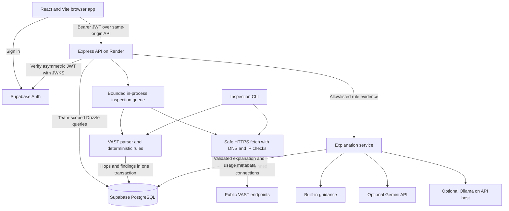

# CTV VAST Tag Inspector

Trace a VAST ad tag through its wrapper chain, inspect the request waterfall, and turn findings into practical fixes.

Built for ad operations teams investigating connected TV ad delivery. Submit a public HTTPS tag or paste VAST XML, review deterministic findings, and optionally generate an explanation with Gemini or a local model. Inspections and explanations are saved to your team's history.

## Features

- Waterfall with each hop's HTTP status, latency, VAST version, and redacted XML structure.
- Eight rule types covering impressions, playback trackers, media compatibility, duration, VAST version, empty responses, wrapper depth, and latency.
- Probable causes and suggested fixes, with built-in guidance that works without an AI account.
- Supabase sign-in and server-enforced team permissions.
- Saved inspection history, explanation caching, an inspection CLI, and labeled evaluation fixtures.

## Architecture



The API serves the built frontend in production. During development, Vite proxies `/api` to Express. The browser talks directly to Supabase for authentication and reads inspection data through the application API.

| Location              | Responsibility                                                          |
| --------------------- | ----------------------------------------------------------------------- |
| `apps/web`            | Sign-in, inspection form, waterfall, explanations, and history          |
| `apps/api`            | JWT verification, team access, job queue, persistence, and explanations |
| `apps/cli`            | Inspect a local XML file or public HTTPS tag                            |
| `packages/vast-core`  | XML parser, wrapper resolver, and deterministic rules                   |
| `packages/safe-fetch` | URL validation, DNS checks, IP pinning, and fetch limits                |
| `drizzle`             | Versioned database migrations                                           |
| `eval`                | Labeled fixtures and generated evaluation report                        |
| `docs/adr`            | Technical decision records                                              |

## Run locally

Use Node.js **22.18 or later**, npm, and a Supabase project with asymmetric JWT signing keys. From the repository root, run `npm ci` and copy `.env.example` to `.env`.

| Variable                   | Value                                                            |
| -------------------------- | ---------------------------------------------------------------- |
| `DATABASE_URL`             | PostgreSQL URI for your Supabase project, with TLS enabled       |
| `SUPABASE_URL`             | HTTPS project origin, such as `https://YOUR-PROJECT.supabase.co` |
| `SUPABASE_PUBLISHABLE_KEY` | The same project's `sb_publishable_...` key                      |
| `EXPLANATION_PROVIDER`     | `rules` by default, or `gemini` / `ollama`                       |
| `GEMINI_API_KEY`           | Server-only key when using Gemini                                |
| `HOST` / `PORT`            | Local defaults are `127.0.0.1` / `3000`                          |

The database URI, project URL, and publishable key must refer to the same Supabase project. The publishable key reaches the browser through `/api/config`. Database credentials and the Gemini key stay on the server.

```sh
npm run db:check
npm run db:migrate
```

Tables live in the **`vast_inspector` schema**. Select that schema in the Supabase dashboard to see them.

The `max_severity` migration preserves existing rows by creating a nullable column, backfilling it from findings, and then enforcing non-null and allowed-value constraints in ordered migrations. This lets historical records acquire a valid value before the database requires one.

Create a user in Supabase Authentication, copy their user UUID, and replace `AUTH_USER_UUID` below. Run this once in the Supabase SQL Editor to create a demo team and give the user an admin profile.

```sql
insert into vast_inspector.teams (id, name)
values ('00000000-0000-4000-8000-000000000001', 'Demo team')
on conflict (id) do nothing;

insert into vast_inspector.profiles (user_id, team_id, role)
select id, '00000000-0000-4000-8000-000000000001', 'admin'
from auth.users
where id = 'AUTH_USER_UUID'
on conflict (user_id) do nothing;
```

Use `ad_ops` or `viewer` for additional users as appropriate. Profile changes are administrative database operations.

Run `npm run dev` and `npm run dev:web` in separate terminals. Open the URL printed by Vite, usually `http://127.0.0.1:5173`, and sign in. `/api/health` returns `{"status":"ok"}` for API liveness.

## Try an inspection and explanation

Paste the contents of `packages/vast-core/test/fixtures/inline-no-impression.xml` into **Paste XML** and run the inspection. It produces `IMP-MISSING`.

Open the completed run and click **Explain findings**. The panel shows a probable cause and **Suggested fixes**. **Rule guidance** identifies the built-in provider. **Model generated** identifies a model response. **Regenerate explanation** is available when the configured model or prompt version differs from the saved explanation.

Select a saved run in **History** to reopen its waterfall and saved explanation. An inspection finishes as `done` when resolution succeeds, even when rules report errors. A `failed` inspection records a resolution or processing error.

The CLI can inspect the same fixture without a database or login.

```sh
npm run inspect -- packages/vast-core/test/fixtures/inline-no-impression.xml
npm run inspect -- --url "https://YOUR-PUBLIC-HOST.example/tag.xml"
```

The CLI exits with code `1` for a resolution failure or an error-severity finding. Local file mode parses the document without following remote wrappers.

### Optional model providers

For Gemini, set `EXPLANATION_PROVIDER=gemini` and `GEMINI_API_KEY`, then restart the API. The adapter currently uses `gemini-3.1-flash-lite`. Account quotas and billing depend on the Google project. A provider rejection or invalid response falls back to built-in guidance.

For Ollama, run `ollama pull qwen3:4b`, start Ollama on the API machine, and set `EXPLANATION_PROVIDER=ollama`. The adapter connects to `127.0.0.1:11434`. On Render, this address refers to the Render host.

The model receives allowlisted rule IDs, fixed descriptions, and bounded severity counts. The prompt omits raw XML, tag URLs, creative text, and finding messages. Responses must pass a strict schema, reference exactly the supplied rules, and include a fix for every rule. Cache keys include canonical evidence, model, and prompt version, with team-scoped lookup.

## Deploy on Render

Use `npm ci && npm run build` as the build command and `npm start` as the start command. Set `HOST=0.0.0.0`, let Render supply `PORT`, and use `/api/health` as the health check path.

Set `DATABASE_URL`, `SUPABASE_URL`, and `SUPABASE_PUBLISHABLE_KEY` in the service environment. Configure explanation variables if needed. Apply `npm run db:migrate` against the target database before starting a release that needs schema changes. The server does not migrate automatically.

The deployed root serves the frontend after a successful build. The health endpoint checks liveness. Check database connectivity and migrations separately.

## API and permissions

Inspection routes require `Authorization: Bearer <access_token>` and a database team profile.

| Method and path                     | Purpose                                  | Minimum role |
| ----------------------------------- | ---------------------------------------- | ------------ |
| `GET /api/inspections`              | Paginated team history                   | `viewer`     |
| `GET /api/inspections/access`       | Role and explanation configuration       | `viewer`     |
| `GET /api/inspections/:id`          | Hops, findings, and saved explanation    | `viewer`     |
| `POST /api/inspections`             | Submit a source, returns `202` and an ID | `ad_ops`     |
| `POST /api/inspections/:id/explain` | Generate or reuse an explanation         | `ad_ops`     |
| `DELETE /api/inspections/:id`       | Delete a team inspection                 | `admin`      |

Submit `{ "type": "url", "value": "https://..." }` or `{ "type": "xml", "value": "<VAST>...</VAST>" }`. Admins also have ad operations and viewer permissions. History accepts `limit` from 1 to 100 and a nonnegative `offset`. Objects outside the caller's team return `404`.

## Threat model

Trust boundaries are the browser, API, third-party VAST endpoints, Supabase, and optional model providers. Protected assets include team records, tokens, credentials, and the server's network access. This table uses OWASP Top 10 **2025**, with 2021 identifiers for the original project brief. [OWASP Top 10](https://top10.owasp.org/2025/)

| Threat                                                       | OWASP mapping                                                                         | Implemented controls                                                                                                                                                                                      | Remaining exposure                                                                                                                         |
| ------------------------------------------------------------ | ------------------------------------------------------------------------------------- | --------------------------------------------------------------------------------------------------------------------------------------------------------------------------------------------------------- | ------------------------------------------------------------------------------------------------------------------------------------------ |
| SSRF through tags, wrappers, redirects, or DNS rebinding     | A01:2025 Broken Access Control / A10:2021 SSRF                                        | HTTPS on port 443, no URL credentials, validate all resolved addresses, reject private and reserved ranges, pin the selected IP while verifying the original TLS hostname, repeat validation per redirect | Deployment routing needs appropriate egress controls. Public endpoints can be slow or malicious.                                           |
| SQL, XML, script, or prompt injection                        | A05:2025 / A03:2021 Injection                                                         | Parameterized Drizzle queries, strict request validation, blocked DTD/entity declarations, bounded XML depth, text rendering, fixed model evidence and validated responses                                | Generated fixes can be inaccurate. Parser checks cover supported fields and rules.                                                         |
| Cross-team reads or unauthorized writes                      | A01:2025 / A01:2021 Broken Access Control                                             | Verify JWT signature, issuer, audience, expiry, subject, and algorithm. Load team and role from the database. Scope data operations and explanation caches by team                                        | Isolation is enforced in the API. Migrations install no database RLS policies. Direct database access needs separate privilege management. |
| Exposed secrets, permissive CORS, or unsafe browser defaults | A02:2025 / A05:2021 Security Misconfiguration                                         | Helmet and CSP, same-origin API, no CORS grants, no-store inspection responses, generic errors, server-only secrets, redacted previews, Gitleaks in CI                                                    | CSP permits inline styles for waterfall widths. Browser sessions use Supabase's default session storage. Deployment settings need review.  |
| Vulnerable dependencies or compromised updates               | A03:2025 Software Supply Chain Failures / A06:2021 Vulnerable and Outdated Components | Lockfile, reproducible installs, Dependabot, dependency review, dated audit results                                                                                                                       | Advisories and transitive dependencies change. Development tooling can retain advisories.                                                  |

SSRF falls under Broken Access Control in 2025. Vulnerable components are covered by Software Supply Chain Failures. [OWASP A01](https://top10.owasp.org/2025/A01_2025-Broken_Access_Control/), [OWASP A03](https://top10.owasp.org/2025/A03_2025-Software_Supply_Chain_Failures/)

### Security review

Reviewed locally on **19 November 2026**. Application response checks confirm CSP, HSTS, `nosniff`, same-origin framing, `no-referrer`, and no `X-Powered-By`. CSP limits browser connections to the app origin and configured Supabase origin. Requests carrying an untrusted Origin receive no CORS allow-origin or allow-credentials headers. Production uses one origin, and development uses Vite's proxy. Render edge behavior requires verification on the deployed URL.

Authenticated users have a general limit of 120 inspection API requests per minute, with additional limits of 10 submissions and 5 explanation requests per minute. Counters and the queue are local to each process.

| Audit                  | Result on 19 November 2026                                                                                                          |
| ---------------------- | ----------------------------------------------------------------------------------------------------------------------------------- |
| `npm audit`            | Four moderate findings, zero high or critical                                                                                       |
| `npm audit --omit=dev` | Zero reported vulnerabilities                                                                                                       |
| Remediation            | Updated the locked `typescript-eslint` family to 8.73.0 within the declared version range, clearing seven affected-package findings |

The remaining affected packages are `drizzle-kit`, `@esbuild-kit/esm-loader`, `@esbuild-kit/core-utils`, and their nested `esbuild`. They trace to an esbuild development-server cross-origin advisory. The app serves its production build through Express, and migration execution uses Drizzle ORM. Drizzle Kit remains development tooling for schema work. The audit proposes downgrading Drizzle Kit to 0.18.1, outside the declared range. That downgrade requires a separate compatibility review. Keep development servers local and revisit this dependency chain when an appropriate upstream update is available. Full `npm audit` therefore exits with a nonzero status. [esbuild advisory](https://github.com/advisories/GHSA-67mh-4wv8-2f99)

## Evaluation and checks

Run `npm run eval` to regenerate [the full report](eval/report.md). On **19 November 2026**, prompt version `vast-findings-v2` produced these results using built-in guidance.

| Metric                              | Result                             |
| ----------------------------------- | ---------------------------------- |
| Exact rule-set agreement            | 17 / 17 fixtures, 100%             |
| Per-rule precision and recall       | 100% across all eight rule types   |
| Explanation schema validation       | 100%                               |
| Exact finding-reference agreement   | 13 / 13 cases, 100%                |
| Unknown rule IDs                    | 0% of schema-valid attempts        |
| Creative-text injection fixture     | Passed                             |
| Median built-in explanation latency | 0.05 ms per case in this local run |
| Built-in API cost                   | $0 per explanation                 |

Fixtures cover clean inline ads and pods, wrappers, empty responses, simulated latency, missing metadata, and hostile creative text. This small labeled set measures fixture agreement and response validity. Live Gemini and Ollama quality, latency, and cost have not been benchmarked in this report. Output validation does not establish the correctness of a suggested fix.

Use `npm run eval -- --gemini` or `npm run eval -- --local` to measure an enabled provider. Each evaluation overwrites `eval/report.md`, so preserve reports before comparing runs. Gemini cost remains unknown when usage is returned without pricing or billing-tier information.

```sh
npm run format:check
npm run lint
npm run typecheck
npm test
npm run build
npm run test:e2e
npm audit
npm audit --omit=dev
```

Set `TEST_DATABASE_URL` to a dedicated disposable PostgreSQL database for integration and browser tests. Without it, database integration tests are skipped. Browser tests require a built frontend and installed Playwright Chromium. CI provisions PostgreSQL and installs the browser.

## Limitations

- The engine checks supported VAST fields and rules. Complete XSD validation, video playback, codec-byte inspection, tracking-pixel firing, and VPAID, SIMID, or verification-script execution are outside its scope.
- Wrapper traversal follows the first ad in each response. Multiple inline ads are parsed. Branching wrapper pods require further work.
- Media compatibility uses declared MP4 MIME types and compatible or unspecified codecs. Duration findings cover missing or invalid declared duration. Actual video duration and device playback need separate checks.
- Defaults allow five wrapper levels, five HTTP redirects per fetch, 1 MiB XML bodies, 48 XML nesting levels, an eight-second fetch deadline, and a 2.5-second connection deadline. Latency warnings start above one second per hop or three seconds across the chain. Library options allow tuning these thresholds.
- Saved previews contain allowlisted XML structure with values and attributes removed, capped at 16 KiB of text. Stored tag references contain origins. The current browser session retains the most recently submitted raw XML for preview.
- The in-memory queue runs two jobs at a time with capacity for 16 outstanding jobs. Restarts lose pending work. Recovery marks work older than 15 minutes as `JOB_EXPIRED`. Durable workers and shared rate limits remain future work.
- Rule IDs and counts give explanations limited context. They cannot identify a partner, URL, or affected creative from the source tag. Similar evidence may reuse a team-cached explanation. Users must review fixes before applying them.
- Team-management UI, automated data retention, and a full security event audit trail remain future work. Fixture tests and audits cover their stated checks at the time they run.

## Technical decisions

- [001 — SSRF protections and IP pinning](docs/adr/001-ssrf-protections.md)
- [002 — Team access through the API](docs/adr/002-team-access.md)
- [003 — Rules first, LLM second](docs/adr/003-rules-first.md)
- [004 — Persistence, migrations, and job recovery](docs/adr/004-persistence-and-recovery.md)
